# Hinweis {#sec-note .unnumbered .unlisted}

Im vorliegenden Dokument wird bei der Bezeichnung von Personen eine geschlechtsneutrale Formulierung verwendet.
Basis bildet der Leitfaden der Bundeskanzlei.
Je nach Situation kommen Paarformen (Bürgerinnen und Bürger), geschlechtsabstrakte Formen (versicherte Person), geschlechtsneutrale Formen (Versicherte) oder Umschreibungen ohne Personenbezug zum Einsatz.
Das generische Maskulin (Bürger) ist nicht zulässig.
Vollformen werden in fortlaufenden Texten verwendet, also in Texten, die aus ausformulierten Sätzen bestehen.
In verknappten Textpassagen, namentlich in Tabellen, können Kurzformen verwendet werden.
Dabei wird die Kurzform mit Schrägstrich, aber ohne Auslassungsstrich verwendet (Referent/in).
Genderstern und ähnliche Schreibweisen werden nicht verwendet.

# Einleitung {#sec-introduction}

Die Weiterverwendung von Daten ist ein zentraler Bestandteil der digitalen Transformation des Schweizer Agrar- und Ernährungssektors.
Im landwirtschaftlichen Kontrollwesen werden Daten in Form von Resultaten und Eigenschaften von Kontrollen erhoben.
Diese Daten dienen in erster Linie der Oberaufsicht über den rechtskonformen Vollzug in den Kantonen und der Festlegung risikobasierter Kontrollen.
Zudem dienen sie der Berichterstattung, der Unterstützung privatrechtlicher Kontrollen und der Weiterentwicklung der Agrarpolitik.

## Status {#sec-status}



## Zielbild der Arbeitsgruppe {#sec-target-picture}

Der Aktionsplan Kontrollen auf Landwirtschaftsbetrieben hat ein klares übergeordnetes Ziel: Die administrative Belastung der Landwirtinnen und Landwirte durch Kontrollen soll sinken, konkret auf höchstens eine Grund- oder Standardkontrolle pro Jahr und Betrieb [@blw2025aktionsplan].
Dies kann nur gelingen, wenn Doppelspurigkeiten zwischen öffentlich-rechtlichen Kontrollen (Bund und Kantone) und privatrechtlichen Kontrollen (Labels wie Bio Suisse, IP-Suisse oder SwissGAP) vermieden werden.

Damit eine Organisation auf eine eigene Kontrolle verzichten kann, muss sie die Kontrollergebnisse einer anderen Organisation anerkennen und nutzen können.
Das funktioniert heute nicht reibungslos, weil die Akteure unterschiedliche «Sprachen» sprechen – fachlich (Begriffe) und technisch (Datenstrukturen).

Die eCH-Arbeitsgruppe Landwirtschaftliche Kontrolldaten kümmert sich deshalb um die semantische und technische Interoperabilität von Kontrolldaten.
Sie erarbeitet das Wörterbuch (Fachglossar), die Grammatik (Geschäftsobjekte), konkrete Anwendungen (Anwendungsfälle), darauf basierend ein konzeptuelles und ein logisches Datenmodell und eine Struktur für die langfristige Pflege (Governance).
Die Arbeitsgruppe hat sich am 4. März 2026 auf folgendes Hauptziel geeinigt:

> Das Ziel ist, Kontrolldaten auszutauschen und als Folge dessen auf Kontrollen verzichten zu können.
> Weiter soll für alle Beteiligten transparent sein, was genau kontrolliert wird und was die Anforderungen sind.

## Landwirtschaftliche Kontrollen {#sec-agricultural-inspections}

Betriebe, die Direktzahlungen beziehen, müssen den ökologischen Leistungsnachweis (ÖLN) erfüllen und können sich zusätzlich für freiwillige Direktzahlungsprogramme anmelden [@dzv].
Darüber hinaus können sich Betriebe bei privaten Label-Organisationen für Produktionsweisen zertifizieren lassen, die über die öffentlich-rechtlichen Anforderungen hinausgehen, zum Beispiel für die integrierte Produktion (IP-Suisse) oder die biologisch-dynamische Landwirtschaft (Demeter) [@ipsuisse; @demeter]. Anforderungen an die biologische Landwirtschaft werden sowohl öffentlich-rechtlich (Bio-Verordnung) als auch privatrechtlich vorgegeben (Bio Suisse) [@biov; @biosuisse].

Die Einhaltung der gesetzlichen Anforderungen, des ÖLN und der Direktzahlungsprogramme wird im Rahmen von Grundkontrollen und risikobasierten Kontrollen überprüft [@vkkl].
Ganzjahresbetriebe müssen innerhalb von acht Jahren mindestens zweimal vor Ort kontrolliert werden, Sömmerungsbetriebe mindestens einmal; für weitere Direktzahlungsbereiche gilt in der Regel eine Mindesthäufigkeit von einmal in acht Jahren [@vkkl].
Zusätzlich werden risikobasierte Kontrollen durchgeführt, etwa bei Mängeln in früheren Kontrollen, bei begründetem Verdacht, bei wesentlichen betrieblichen Änderungen oder in jährlich festgelegten Bereichen mit höherem Risiko [@vkkl].
Zentraler Bestandteil der Grundkontrollen ist ein Betriebsrundgang; hinzu kommen die Prüfung von Aufzeichnungen und Dokumenten sowie Gespräche mit den Bewirtschafterinnen und Bewirtschaftern [@vkkl].
Werden Mängel festgestellt, können je nach Art und Schwere die Direktzahlungen gekürzt werden [@dzv].

## Datenflüsse von Kontrolldaten {#sec-data-flows}

Die Daten öffentlich-rechtlicher Kontrollen fliessen im System Acontrol zusammen, das vom Bundesamt für Landwirtschaft (BLW) und vom Bundesamt für Lebensmittelsicherheit und Veterinärwesen (BLV) gemeinsam genutzt wird [@acontrol]. Die Datenflüsse unterscheiden sich je nach Kanton:

- Kontrollpersonen erfassen die Resultate bei der Kontrolle auf dem Betrieb mit einer Tablet-Applikation, zum Beispiel ACmobile oder eControls. Je nach Kanton gehen die Daten zuerst in das kantonale Agrarinformationssystem (KAIS) und von dort an Acontrol. Sie können auch direkt von der Applikation an Acontrol gehen. Teilweise fehlen Schnittstellen, zum Beispiel im Wallis: eControls generiert für einen Teil der Kontrolldaten eine für Acontrol passende XML-Datei auf. Der Kanton lädt die Daten dann manuell herunter und importiert sie in Acontrol. Das kantonale System im Wallis speichert keine Kontrolldaten, nur die Beträge von Kürzungen. Der Kanton bezieht die Resultate für die Prüfung und die Bearbeitung von Mängeln aus Acontrol.
- Kontrollstellen im Auftrag der Kantone übermitteln ihre Resultate an die Kantone. Mängel sind meldepflichtig. Ein Teil dieser Angaben geht per E-Mail an bis zu 18 Kantone, weil das Acontrol-Schema nicht alle nötigen Felder enthält. Auch Kantonschemiker und Gewässerschutzstellen ohne KAIS-Zugriff, zum Beispiel im Tessin, erhalten meldepflichtige Daten per E-Mail.
- Bio-Kontrollstellen führen jährlich Kontrollen im privatrechtlichen und alle vier jahre im öffentlich-rechtlichen Auftrag durch. Die Kantone erhalten nur die öffentlich-rechtlichen und die meldepflichtigen Resultate. Einige Kontrollstellen, zum Beispiel Bio Test Agro, senden auch privatrechtliche Resultate an die Kantone. Im Wallis erfassen Bio-Kontrollstellen ihre Resultate direkt in Acontrol. Der Kanton wertet alle diese Resultate aus und bearbeitet so auch Mängel, die ausserhalb der kantonal beauftragten Kontrollen festgestellt wurden.
- Datenbezügerinnen und Datenbezüger können seit September 2026 Acontrol-Daten mit Einverständnis der Bewirtschafterinnen und Bewirtschafter über agridata.ch (früher «Meine Agrardatenfreigabe», MAF) beziehen.

Privatrechtliche Kontrolldaten werden nicht an Acontrol übermittelt. Einige Kantone speichern sie trotzdem. Kontrollorganisationen müssen sie deshalb bei jedem Kanton einzeln abholen. Auch kantonale Kontrollpunkte der Landwirtschaftsämter, zum Beispiel zu Vernetzungs- und Landschaftsqualitätsprojekten, gehen nicht an Acontrol. Die Veterinärämter erfassen ihre Kontrollpunkte direkt in Acontrol.

## Hierarchie und Entstehung von Kontrollpunkten {#sec-control-point-hierarchy}

Öffentlich-rechtliche Kontrollpunkte sind hierarchisch gegliedert:

- Kontrollbereich (zum Beispiel Lebensmittelsicherheit)
    - Kontrollrubrik (zum Beispiel Tierarzneimittel)
        - Punktegruppe (optional, zum Beispiel Schweinehaltung)
            - Kontrollpunkt (zum Beispiel «Aufbewahrungs- und Lagerungsvorschriften eingehalten»)

Das BLW legt die Kontrollrubriken und Kontrollpunkte des Direktzahlungssystems fest, das BLV jene zu Tierschutz, Tiergesundheit und Lebensmittelsicherheit.
Zusätzlich führt das BLW seit 2020 eine Kontrollrubrik «Gewässerschutz» für das Bundesamt für Umwelt (BAFU).
Die Rubriken und Punkte werden jeweils im Herbst mit Gültigkeit ab dem 1. Januar des Folgejahres veröffentlicht. Kontrollpunkte können nicht zu Rubriken hinzugefügt, oder entfernt werden.
Kantonale Veterinärämter erstellen zusätzliche kantonsspezifische Kontrollrubriken direkt in Acontrol; die kantonsspezifischen Kontrollrubriken der Landwirtschaftsämter werden nicht an Acontrol übermittelt.
Label-Organisationen erstellen ihre Kontrollpunkte selbständig und passen Richtlinien und Ausnahmeregelungen bei Bedarf unterjährig an.
Führt eine Kontrollstelle öffentlich-rechtliche und privatrechtliche Kontrollen gemeinsam durch, zum Beispiel bei Bio-Kontrollen, erhält sie die öffentlich-rechtlichen Kontrollpunkte vom Kanton und die privatrechtlichen von der Label-Organisation, zum Beispiel von Bio Suisse.
Sie führt dann eine Kontrolle mit allen Kontrollpunkten durch.
Bei der Kontrollplanung werden die Kontrollpunkte zusammengestellt und die möglichen Ergebnisse, Massnahmen und Sanktionen definiert.

Damit bestehen vier Quellen von Kontrollpunkten: der Bund (BLW, BLV, BAFU), die kantonalen Veterinärämter, die kantonalen Landwirtschaftsämter und die Label-Organisationen.
Die Anzahl der Kontrollpunkte je Programm ist sehr unterschiedlich: Der Beitrag für den Verzicht auf Pflanzenschutzmittel im Ackerbau umfasst einen Kontrollpunkt, RAUS für Milchkühe rund zehn.
Insgesamt gibt es in der Schweiz mehrere tausend öffentlich-rechtliche und privatrechtliche Kontrollpunkte; die Webanwendung Agricheck macht sie für Bewirtschaftende zugänglich [@agricheck].

## Kontrolldaten heute {#sec-inspection-data}

Daten aus öffentlich-rechtlichen Kontrollen sind für alle Betriebe, deren Bewirtschafterinnen und Bewirtschafter der Weitergabe zustimmen, über agridata.ch verfügbar.
Pro Kontrollbereich wird ein Datenprodukt angeboten; alle Datenprodukte haben dieselben Merkmale.
Sie umfassen Kontrollen aus dem laufenden und den drei vorangehenden Kalenderjahren beziehungsweise seit dem letzten Bewirtschafterwechsel.
Die tiefste Ebene ist der Kontrollpunkt mit dem Kontrollergebnis und gegebenenfalls der Mangelbeschreibung; Massnahmen sind nicht enthalten.

::: {.callout-important}
Kontrolldaten enthalten keine Stammdaten von Betrieben und Personen, sondern nur Identifikatoren, die als Fremdschlüssel auf die Stammdaten im Agrarpolitischen Informationssystem (AGIS) verweisen.
Dieser Grundsatz soll im künftigen Datenmodell (@sec-data-model) beibehalten werden.
:::

# Akteure und Anwendungsfälle {#sec-actors-use-cases}

## Akteure {#sec-actors}

| Akteur | Rolle im Kontrollwesen | Hauptinteresse an Kontrolldaten |
|:--|:--|:--|
| Bewirtschafterinnen und Bewirtschafter | Kontrollierte Personen, Datenproduzentinnen und Datenproduzenten | Weniger und besser koordinierte Kontrollen, Transparenz über die geltenden Anforderungen |
| BLW, BLV, BAFU | Herausgeber öffentlich-rechtlicher Kontrollpunkte, Oberaufsicht, Betrieb von Acontrol | Vergleichbare, vollständige und plausible Kontrolldaten |
| Kantonale Vollzugsbehörden und Kontrollkoordinationsstellen | Auftraggeber und Verwerter öffentlich-rechtlicher Kontrollen | Einheitliche Datenlieferungen, automatisierte Mängelmeldungen |
| Kontrollstellen (zum Beispiel bio.inspecta, Agrosolution, KUT, KOL) | Durchführung öffentlich-rechtlicher und privatrechtlicher Kontrollen | Ein nationales Schema statt vieler kantonaler Lösungen, Zugriff auf Basisinformationen |
| Label-Organisationen (zum Beispiel Bio Suisse, IP-Suisse, Mutterkuh Schweiz, QM Schweizer Fleisch) | Herausgeber privatrechtlicher Kontrollpunkte, Datenbezüger | Öffentlich-rechtliche Ergebnisse wiederverwenden und eigene Kontrollen reduzieren |
| agridata.ch | Datenübertragungsdienst | Klar beschriebene Datenprodukte, rechtlich abgestützte Einwilligungen |

: Akteure des landwirtschaftlichen Kontrollwesens {#tbl-actors tbl-colwidths="[25,35,40]"}

## Anwendungsfälle {#sec-use-cases}

| ID | Anwendungsfall | Akteure | Benötigte Geschäftsobjekte | Quelle |
|:--|:--|:--|:--|:--|
| UC-01 | Eine Label-Organisation bezieht mit Einwilligung der Bewirtschafterin oder des Bewirtschafters öffentlich-rechtliche Kontrolldaten, um auf eigene Kontrollen zu verzichten oder sie zu vereinfachen (zum Beispiel beef control für Mutterkuh Schweiz, IP-Suisse). | Label-Organisation, BLW, Bewirtschafter/in | Kontrolle, Kontrollumfang, Kontrollergebnis, Mangel, Programmteilnahme | Entwurf, Mutterkuh Schweiz, IP-Suisse |
| UC-02 | Eine Label-Organisation will wissen, ob ein öffentlich-rechtliches Programm (ÖLN, BTS, RAUS, GMF) erfüllt ist; ein Programm kann auch mit einzelnen Mängeln erfüllt sein (der ÖLN gilt zum Beispiel erst ab 110 Sanktionspunkten als nicht erfüllt). | Label-Organisation | Programmteilnahme mit Programmerfüllung, Zertifikat, Sanktion | Entwurf, erweitert (Mutterkuh Schweiz) |
| UC-03 | Eine Kontrollstelle meldet meldepflichtige Mängel strukturiert an die zuständigen Akteure (Landwirtschaftsamt, Kantonschemiker, Gewässerschutz) statt per E-Mail. Die Empfänger filtern die für sie relevanten Resultate. | Kontrollstelle, Kantone, Kantonschemiker, Gewässerschutz | Mangel, Massnahme, Organisation, Kontrollpunkt mit zu informierenden Akteuren | Entwurf, erweitert (Bio.Inspecta) |
| UC-04 | Eine Organisation prüft, welche ihrer Kontrollpunkte durch Kontrollpunkte einer anderen Herausgeberin bereits abgedeckt sind (zum Beispiel QM Schweizer Fleisch und Tierschutz, Demeter und Bio Suisse). | Label-Organisationen, Bund | Kontrollpunkt, Anforderung, Entsprechung von Kontrollpunkten | Entwurf, QM-SF |
| UC-05 | Kontrollergebnisse werden bei einem Bewirtschafterwechsel der verantwortlichen Person zugeordnet, damit Nachfolgerinnen und Nachfolger nicht mit Mängeln konfrontiert werden. | Kantone, Label-Organisationen | Kontrolle, Bewirtschafter/in | Entwurf, KIP |
| UC-06 | Kontrollergebnisse eines Betriebs mit Produktionsstätten in mehreren Kantonen werden der richtigen Produktionsstätte zugeordnet. | Kantone, Kontrollstellen | Betrieb, Produktionsstätte, Tierhaltung | Entwurf, KIP |
| UC-07 | Das BLW plausibilisiert die jährlich gelieferten Kontrolldaten und erkennt, welche Kontrollpunkte tatsächlich kontrolliert wurden. | BLW, Kantone | Kontrollumfang, Kontrollergebnis | Entwurf |
| UC-08 | Kontrollergebnisse werden durch Fotos, Dokumente oder Satellitenbilder belegt und automatisiert oder aufgrund von Selbstdeklarationen erzeugt. | Kontrollstellen, Kantone, BLV | Nachweis, Erhebungsmethode | Entwurf |
| UC-09 | Bewirtschafterinnen und Bewirtschafter und Kontrollstellen sehen, welche Kontrollpunkte für einen Betrieb gelten. | Bewirtschafter/in, Kontrollstellen | Kontrollpunkt, Programmteilnahme | Entwurf |
| UC-10 | Kantonale Landwirtschafts- und Veterinärämter koordinieren ihre öffentlich-rechtlichen Kontrollen, damit ein Betrieb nicht mehrmals pro Jahr von verschiedenen Kontrollpersonen kontrolliert wird. | Kantone (Landwirtschaftsämter, Veterinärämter), Kontrollstellen | Kontrolle, Kontrollumfang, Betrieb | IP-Suisse |
| UC-11 | Eine Label-Organisation bezieht Mängel, Tierzahlen und -kategorien sowie Tierwohlprogramme ohne Rückfrage beim Produzenten (setzt einen rechtlich erlaubten Austausch voraus). | Label-Organisation, Bewirtschafter/in | Mangel, Tierhaltung, Programmteilnahme | QM-SF |
| UC-12 | Eine Label-Organisation bezieht die Ergebnisse kontrollierter Nährstoffbilanzen für die wenigen Betriebe, die sie benötigt, heute per Post oder E-Mail. | Label-Organisation, Kantone | Kontrolle, Kontrollergebnis, Nachweis | Mutterkuh Schweiz |
| UC-13 | Eine Kontrollstelle führt öffentlich-rechtliche und privatrechtliche Kontrollpunkte in einer Kontrolle durch. Die Kantone erhalten nur die öffentlich-rechtlichen Resultate. | Kontrollstelle, Kantone, Label-Organisation | Kontrollpunkt, Kontrolle, Kontrollergebnis | Bio.Inspecta |
| UC-14 | Auf demselben Kontrollpunkt entstehen mehrere Sanktionsarten (zum Beispiel nach Bio-Verordnung und nach Bio Suisse), die getrennt ausgewiesen werden. | Kontrollstellen, Kantone, Label-Organisationen | Kontrollpunkt, Mangel, Sanktion | Bio.Inspecta |
| UC-15 | Kontrollorganisationen beziehen privatrechtliche Kontrolldaten, die Kantone speichern, zentral, standardisiert und tagesaktuell (agridata.ch) statt einzeln bei jedem Kanton. | Kontrollorganisationen, Kantone, BLW | Kontrolle, Kontrollergebnis, Mangel | Bio.Inspecta |
| UC-16 | Alle Kontrollresultate eines Betriebs aus allen Kontrollen sind an einer Stelle verfügbar. | Kantone, Kontrollstellen, Label-Organisationen | Betrieb, Kontrolle, Kontrollergebnis | Bio.Inspecta |
| UC-17 | Bei Feststellungen ausserhalb des Kontrollauftrags (zum Beispiel ungepflegte Klauen) ist erkennbar, ob die Kontrollperson dafür qualifiziert ist. So lässt sich beurteilen, ob eine Folgekontrolle (zum Beispiel durch Veterinärinnen und Veterinäre) nötig ist. | Kontrollstellen, Kantone | Kontrollperson mit Qualifikation, Kontrollergebnis | Bio.Inspecta |
| UC-18 | Kontrollorganisationen planen Kontrollen anhand aktueller Anmeldedaten für die Direktzahlungsprogramme. | Kontrollorganisationen, Kantone, BLW | Programmteilnahme, Kontrollpunkt, Kontrollumfang | Bio.Inspecta |
| UC-19 | Private Kontrollorganisationen melden Mängel zu Anforderungen der Direktzahlungsprogramme an Acontrol oder die Kantone, damit Kürzungen geprüft werden können (offen, ob und wie das heute geschieht). | Label-Organisationen, Kontrollstellen, Kantone | Mangel, Kontrollpunkt, Massnahme | Marie Zufferey |
| UC-20 | Acontrol setzt Kontrollpunkte von Programmen, für die ein Betrieb nicht angemeldet ist, anhand der AGIS-Anmeldedaten beim Import automatisch auf «nicht zutreffend». | BLW, Kantone | Kontrollpunkt, Programmteilnahme, Kontrollergebnis | Marie Zufferey |

: Anwendungsfälle des landwirtschaftlichen Kontrollwesens {#tbl-use-cases tbl-colwidths="[6,38,18,23,15]"}

## Einschränkungen der heutigen Kontrolldaten {#sec-limitations}

Die Wiederverwendbarkeit öffentlich-rechtlicher Kontrolldaten entspricht nicht den Bedürfnissen der Akteure.
Das liegt teils an der Form der Daten, die ihre Interpretation erschwert, teils am Umfang der erhobenen Daten.
Während die Form der bereits erhobenen Daten durch einheitliche Begriffe und ein künftiges Datenmodell verbessert werden kann, lässt sich die Datenerhebung selbst nur mit grossem Aufwand erweitern.

**Fehlende einheitliche Definitionen.**
Datenbezügerinnen und Datenbezüger haben Schwierigkeiten, Kontrolldaten zu interpretieren, weil die Begriffe in den Kontrollpunkten nicht einheitlich definiert sind.
Semantische Interoperabilität setzt voraus, dass alle Akteure Begriffsdefinitionen aus demselben Glossar verwenden (@sec-glossary).

**Begrenzter Informationsgehalt der Kontrollergebnisse.**
In Acontrol können nur die Ergebnisse «Mangel», «nicht zutreffend» (NZ) und «nicht kontrolliert» (NK) erfasst werden; fehlt ein Ergebnis, gilt der Kontrollpunkt als «ohne Mangel».
Bei Grundkontrollen müssen zudem nur die Fokuskontrollpunkte geprüft werden, und nicht geprüfte übrige Kontrollpunkte müssen nicht als «nicht kontrolliert» gekennzeichnet werden.
Das senkt den Erfassungsaufwand, führt aber dazu, dass nicht erkennbar ist, welche Kontrollpunkte tatsächlich kontrolliert wurden. 
In der Applikation eControls im Kanton Wallis wird für jeden Kontrollpunkt ein explizites Ergebnis («in Ordnung», «Mangel», «nicht kontrolliert» oder «nicht zutreffend») verlangtund setzen bei Fokuskontrollen nicht gezielt geprüfte Kontrollpunkte automatisch auf «nicht kontrolliert». Es gibt noch Fehlerquellen und teilweise werden Kontrollpunkte von Programmen, für die ein Betrieb nicht angemeldet ist, mit «in Ordnung» statt «nicht zutreffend» erfasst. Das betrifft insbesondere die Tierwohlprogramme: Die Tierbestandsdaten für die Berechnung der Direktzahlungen liegen ein Jahr zurück, und die Anmeldungen für Direktzahlungsprogramme werden nicht immer geprüft.

::: {.callout-note title="Das Chüngeli-Problem"}
Acontrol kennt die Kontrollrubriken nur als Ganzes.
Planen Kantone Kontrollen mit einzelnen Kontrollpunkten und liefern nur diese, ergänzt Acontrol die übrigen Kontrollpunkte der Rubrik automatisch mit dem Ergebnis «ohne Mangel».
So entstehen Ergebnisse zu Kontrollpunkten, die gar nicht kontrolliert wurden, zum Beispiel zur Haltung von Straussen auf Betrieben, die nur Hühner halten.
:::

**Sammel-Kontrollpunkte.**
Manche Kontrollpunkte fassen viele Anforderungen zusammen, zum Beispiel «BFF-Auflagen eingehalten».
Label-Organisationen können dann nicht beurteilen, ob ihre spezifischen Anforderungen geprüft wurden.

**Identifikation der Kontrollobjekte.**
Kontrollergebnisse beziehen sich je nach Bereich auf den Betrieb, die Produktionsstätte oder die Tierhaltung.
Label-Organisationen identifizieren ihre Mitglieder teilweise nur über die TVD-Nummer, agridata.ch dagegen über die Unternehmens-Identifikationsnummer (UID) [@uid-register] und die BUR-Nummer [@bur; @digiagrifood-stammdaten]; nicht bei jeder Tierhaltung ist eine TVD-Nummer hinterlegt.

**Limitierte historische Daten und Aktualität.**
Über agridata.ch sind höchstens die Kontrollen der letzten vier Kalenderjahre verfügbar, der Kontrollrhythmus beträgt aber bis zu acht Jahre.
Vor 2020 sind die Daten lückenhaft.
Zudem stehen Ergebnisse oft erst nach der Plausibilisierung im Folgejahr zur Verfügung – für die Planung privatrechtlicher Kontrollen häufig zu spät.

**Fehlende Angaben.**
Fehlende Angaben in den heute verfügbaren Kontrolldaten umfassen Massnahmen und Sanktionen, die Qualifikation der Kontrollperson, die Erhebungsmethode und Nachweise wie Fotos. 
Auf einem Kontrollpunkt können zudem verschiedene Massnahmen und Sanktionen zutreffen, insbesondere wenn der Kontrollpunkt gleichzeitig im Rahmen mehrerer Aufträge kontrolliert wurde (z.B. Bio-Verordnung und Bio-Suisse).
Die Qualifikation der Kontrollperson ist nötig, um bei Feststellungen ausserhalb des Auftrags zu beurteilen, ob eine Folgekontrolle ausgelöst werden muss.

# Fachglossar Kontrollwesen {#sec-glossary}

Das Fachglossar Kontrollwesen definiert die für das landwirtschaftliche Kontrollwesen relevanten Begriffe und ihre Beziehungen.
Es dient als *Single Source of Truth* für Begriffsdefinitionen und bildet die Grundlage für das künftige logische Datenmodell (@sec-data-model).
Das Glossar wird vom BLW gepflegt und kann aufgrund der Bedürfnisse des Sektors erweitert und angepasst werden.

Die vollständige Liste der Begriffe findet sich in [Anhang C](#sec-appendix-c).

## Aufbau des Glossars {#sec-glossary-structure}

Das Glossar ist wie in eCH-0265 als SKOS-Konzeptschema modelliert [@skos].
Jeder Begriff ist ein `skos:Concept` mit einer dauerhaften IRI im Namensraum `https://agriculture.ld.admin.ch/eCH-0264/1/term/` und hat:

- eine Benennung (`schema:name`), wo verfügbar auch auf Französisch und Italienisch,
- Synonyme und Abkürzungen (`schema:alternateName`),
- eine Definition (`schema:description`),
- Anmerkungen und Kontextinformationen (`skos:scopeNote`),
- eine Quellenangabe (`schema:citation`), bei Rechtsbegriffen die Fundstelle auf fedlex.admin.ch,
- Beziehungen zu Ober-, Unter- und verwandten Begriffen (`skos:broader`, `skos:related`).

Die Begriffe sind in thematische Sammlungen (`skos:Collection`) gegliedert: Akteure und Rollen; Kontrollobjekte und Identifikatoren; Regelwerke, Programme und Anforderungen; Kontrollpunkte; Kontrolle und Kontrollergebnis; Mängel, Massnahmen und Zertifizierung; Datenaustausch und Systeme.

## Grundsätze der Terminologiearbeit {#sec-glossary-principles}

Die Definitionen folgen den Grundsätzen der Terminologiearbeit gemäss ISO 704 und eCH-0128 [@eCH-0128:1.1]:

- Wo vertrauenswürdige Definitionen bestehen, insbesondere in der Landwirtschaftlichen Begriffsverordnung [@lbv] und der VKKL [@vkkl], werden diese sinngemäss übernommen und mit ihrer Fundstelle angegeben.
- Definitionen nennen einen Oberbegriff und die abgrenzenden Merkmale; Aufzählungen von Unterarten sind abschliessend.
- Zirkelbezüge und Negativdefinitionen werden vermieden.
- Begriffe derselben Familie werden nach demselben Prinzip definiert.
- Informationen, die für das Verständnis wichtig, aber nicht Teil der Definition sind, stehen in den Anmerkungen.

Wo im Material für denselben Sachverhalt unterschiedliche Begriffe verwendet werden, legt das Glossar eine Vorzugsbenennung fest und führt die übrigen als Synonyme, zum Beispiel «Mangel» mit den Synonymen «Beanstandung» und «Abweichung».
Uneinheitlich verwendete Begriffe wie «Teilbetrieb» werden mit einer Anmerkung auf die rechtlich definierten Begriffe verwiesen.

## Governance {#sec-governance}

Damit das Glossar verlässlich bleibt, wird folgende Governance umgesetzt:

- **Verantwortung:** Das BLW pflegt das Glossar im Rahmen der eCH-Fachgruppe AgriFood. Fachliche Entscheide werden in der Arbeitsgruppe Landwirtschaftliche Kontrolldaten vorbereitet.
- **Änderungsprozess:** Änderungsanträge werden als GitHub-Issue oder über <agridata.ch@blw.admin.ch> eingereicht, in der Arbeitsgruppe besprochen und als Pull Request umgesetzt. Automatisierte Tests stellen sicher, dass das Glossar konsistent bleibt.
- **Versionierung:** Das Glossar wird nach Semantic Versioning versioniert. Nur eine inkompatible Änderung erhöht die Hauptversion und damit den Namensraum (`https://agriculture.ld.admin.ch/eCH-0264/1/`).
- **Jahreszyklus:** Änderungen am Glossar werden auf die jährliche Veröffentlichung der öffentlich-rechtlichen Kontrollpunkte im Herbst abgestimmt.

# Datenmodell {#sec-data-model}

Das Datenmodell beschreibt die Geschäftsobjekte des landwirtschaftlichen Kontrollwesens, ihre Merkmale und Beziehungen. 
Es baut auf den Begriffen des Fachglossars (@sec-glossary) auf und leitet sich aus den Anwendungsfällen und Bedürfnissen der Akteure ab (@sec-use-cases).
Das konzeptionelle Datenmodell (@fig-conceptual-model) beschreibt die Geschäftsobjekte unabhängig von einer Technologie.
Es richtet sich an Fachpersonen, verwendet die Begriffe des Fachglossars und zeigt nur die Geschäftsobjekte und ihre Beziehungen. 
Das logische Datenmodell beschreibt Attribute, Datentypen und Kardinalitäten (@sec-logical-model).

Das Datenmodell unterscheidet zwei Arten von Daten:

- **Referenzdaten** legen fest, was kontrolliert wird.
  Eine Organisation erlässt ein Regelwerk, zum Beispiel eine Verordnung oder eine Label-Richtlinie, in einer bestimmten Fassung.
  Ein Regelwerk ist öffentlich-rechtlich oder privatrechtlich und enthält Anforderungen.
  Ein Programm, zum Beispiel ein Direktzahlungsprogramm wie RAUS oder BTS, ist in einem Regelwerk festgelegt und umfasst die Anforderungen, zu deren Einhaltung sich ein Betrieb mit der Anmeldung verpflichtet.
  Ein Kontrollpunkt prüft eine oder mehrere Anforderungen und wird von einer Organisation herausgegeben.
  Alle Anforderungen eines Kontrollpunkts stammen aus Regelwerken mit derselben Rechtsnatur (öffentlich-rechtlich, oder privatrechtlich).
  Der Kontrollpunkt legt mindestens ein mögliches Ergebnis fest, zum Beispiel einen vordefinierten Mangel.
  Jeder Kontrollpunkt ist einem Gliederungselement zugeordnet.
  Gliederungselemente können einem übergeordneten Gliederungselement angehören und so beliebig tief verschachtelt werden, zum Beispiel als Kontrollbereich, Rubrik und Gruppe.
  Jede Herausgeberin veröffentlicht ihre gültigen Kontrollpunkte in einem Kontrollpunktkatalog, zum Beispiel das BLW jährlich in der Masterliste oder eine Label-Organisation bei jeder Änderung ihrer Richtlinien.
  Zu einem Katalog kann eine Auswahl der Fokuskontrollpunkte gehören.
  Ein neuer Kontrollpunkt kann einen oder mehrere frühere Kontrollpunkte derselben Herausgeberin ersetzen.
  Ein Kontrollpunkt kann eine Qualifikation erfordern, die eine Kontrollperson besitzen muss, um ihn abschliessend zu prüfen.
  Kontrollpersonen gehören einer oder mehreren Organisationen an, zum Beispiel einer Kontrollstelle oder einem kantonalen Veterinäramt.
- **Transaktionsdaten** entstehen bei einer Kontrolle oder einer Anmeldung und fliessen zwischen den Systemen.
  Eine Kontrolle hält fest, wann sie stattgefunden hat, welche örtliche Einheit kontrolliert wurde und zu welcher rechtlichen Einheit diese gehört, welche Kontrollperson sie durchgeführt hat, mit welchen Qualifikationen und gegebenenfalls welche Organisation als Kontrollstelle beauftragt war.
  Für jeden kontrollierten Kontrollpunkt wird eine tatsächliche Beobachtung erfasst.
  Sie verweist auf ein vordefiniertes mögliches Ergebnis oder beschreibt eine Abweichung frei, bei Bedarf ergänzt mit einer Menge, zum Beispiel der betroffenen Fläche, und einem Bild.
  Eine Beobachtung kann eine falsch erfasste Beobachtung korrigieren oder auf eine frühere Beobachtung folgen, zum Beispiel bei einer Nachkontrolle.
  Eine Anmeldung hält fest, dass sich ein Betrieb für ein Beitragsjahr für ein Programm angemeldet hat und wann er dies getan hat.

Stammdaten werden nicht modelliert, mit Ausnahme einer Klasse Kontrollperson ohne Namen, die über einen Identifikator identifizierbar ist, den eine Organisation vergibt (@sec-modelling-decisions).
Kontrolle und Anmeldung verweisen auf die örtliche Einheit mit der Nummer des Betriebs- und Unternehmensregisters (BUR-Nummer) [@bur; @digiagrifood-stammdaten] und auf die rechtliche Einheit mit der Unternehmens-Identifikationsnummer (UID) [@uid-register].

## Konzeptionelles Datenmodell {#sec-conceptual-model}

{#fig-conceptual-model width="80%"}

### Modellierungsentscheide {#sec-modelling-decisions}

Die folgenden Abschnitte begründen die wichtigsten Entscheide.
Über jedem Entscheid steht der Ausschnitt des Datenmodells, den er betrifft.
Die Ausschnitte zeigen nur die Beziehungen zum jeweiligen Modellierungsentscheid und das vollständige Modell wird in @fig-conceptual-model gezeigt.

#### Gliederung der Kontrollpunkte in einem Baum {#sec-decision-hierarchy}

::: {.entscheid}
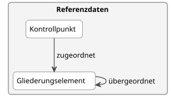{fig-alt="Ausschnitt aus dem konzeptionellen Datenmodell: Kontrollpunkt und Gliederungselement mit der Beziehung übergeordnet"}

Kontrollpunkte werden heute in Kontrollbereiche, Rubriken und Gruppen gegliedert.
Das Datenmodell bildet diese Ebenen nicht als eigene Klassen ab.
Stattdessen ist jeder Kontrollpunkt einem Gliederungselement zugeordnet, und jedes Gliederungselement kann einem übergeordneten Gliederungselement angehören.
So entsteht ein Baum, der beliebig viele Ebenen haben kann.

Wir haben uns aus folgenden Gründen dafür entschieden:

- **Kataloge sind unterschiedlich aufgebaut.**
  Die Kataloge von Bund, Kantonen und privaten Labels haben nicht alle die gleichen Ebenen.
  Manche haben mehr, andere weniger, manche nennen sie anders.
  Mit einer einzigen, verschachtelbaren Struktur passen alle Kataloge ins gleiche Modell, ohne dass es geändert werden muss.
- **Jeder Kontrollpunkt ist gleich eingeordnet.**
  Ein Kontrollpunkt ist immer genau einem Gliederungselement zugeordnet.
  Ob dieses Gliederungselement einer Gruppe oder einer Rubrik entspricht, muss im Modell nicht unterschieden werden.

Dafür sind die Ebenen im Modell nicht mehr fest benannt.
Regeln, die nur für eine bestimmte Ebene gelten, werden erst in der technischen Umsetzung festgelegt.
:::

#### Herkunft der Anforderungen mit Regelwerk und Organisation {#sec-decision-origin}

::: {.entscheid}
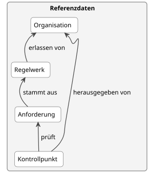{fig-alt="Ausschnitt aus dem konzeptionellen Datenmodell: Organisation, Regelwerk, Anforderung und Kontrollpunkt"}

Heute ist bei vielen Kontrollpunkten nicht klar erkennbar, welche Anforderungen sie prüfen und woher diese stammen.
Das Datenmodell trennt deshalb drei Fragen:

- **Woher kommt die Anforderung?**
  Jede Anforderung stammt aus einem Regelwerk.
  Das Regelwerk hat eine Fassung, eine Rechtsnatur (öffentlich-rechtlich oder privatrechtlich) und wird von einer Organisation erlassen.
- **Wer hat den Kontrollpunkt formuliert?**
  Jeder Kontrollpunkt hat eine Organisation als Herausgeberin.
- **Was prüft der Kontrollpunkt?**
  Ein Kontrollpunkt verweist auf die Anforderungen, die er prüft.
  Ein Kontrollpunkt vermischt nie öffentlich-rechtliche und privatrechtliche Anforderungen.
  Alle seine Anforderungen stammen deshalb aus Regelwerken mit derselben Rechtsnatur.

Wir haben uns aus folgenden Gründen dafür entschieden:

- **Die Quelle wird nur einmal erfasst.**
  Viele Anforderungen stammen aus dem gleichen Regelwerk.
  Wäre die Quelle ein Text bei jeder Anforderung, müsste sie hundertfach wiederholt werden, und Tippfehler wären unvermeidlich.
- **Es ist nachvollziehbar, was zum Kontrollzeitpunkt galt.**
  Regelwerke werden mit ihrer Fassung erfasst.
- **Öffentliches und privates Recht sind klar unterscheidbar.**
  Das ist wichtig, weil für die Weitergabe der Daten unterschiedliche Regeln gelten.
  Die Rechtsnatur eines Kontrollpunkts muss nicht separat erfasst werden, sie ergibt sich aus seinen Anforderungen.
- **Kontrollpunkte verschiedener Herausgeberinnen werden vergleichbar.**
  Prüfen zwei Kontrollpunkte die gleiche Anforderung, zum Beispiel ein Kontrollpunkt des Bundes und ein kantonsspezifischer Kontrollpunkt, ist das im Modell sichtbar.
:::

#### Programme bündeln Anforderungen {#sec-decision-programmes}

::: {.entscheid}
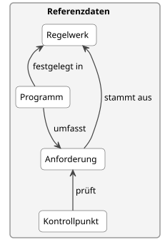{fig-alt="Ausschnitt aus dem konzeptionellen Datenmodell: Regelwerk, Programm, Anforderung und Kontrollpunkt"}

Betriebe melden sich für Programme an, zum Beispiel für Direktzahlungsprogramme wie RAUS oder BTS oder für Label-Programme (Bio, Demeter etc.).
Mit der Anmeldung verpflichten sie sich, die Anforderungen des Programms zu erfüllen.
Das Datenmodell bildet ein Programm deshalb als eigenes Geschäftsobjekt ab, das in einem Regelwerk festgelegt ist und Anforderungen umfasst.

Wir haben uns aus folgenden Gründen dafür entschieden:

- **Eine Anforderung kann zu mehreren Programmen gehören.**
  In der Masterliste  übernimmt zum Beispiel der Weidebeitrag Anforderungen von RAUS: Mehrere Kontrollpunkte des Weidebeitrags verlangen Auslauf «gemäss RAUS», und einzelne Kontrollpunkte kommen in beiden Programmen wortgleich vor.
  Mit einer eigenen Klasse Programm wird eine solche Anforderung nur einmal erfasst und beiden Programmen zugeordnet.
- **Die Zugehörigkeit steht nicht nur im Text.**
  Welche Anforderungen zu einem Programm gehören, ist ausdrücklich erfasst und nicht nur aus der Fundstelle im Regelwerk ablesbar.
  So lassen sich Kontrollergebnisse auch pro Programm auswerten.
- **Programm und Gliederung bleiben getrennt.**
  Wie eine Herausgeberin ihren Katalog gliedert, ist etwas anderes als die Frage, wozu sich ein Betrieb verpflichtet.
  Die Masterliste des BLW teilt zum Beispiel RAUS in mehrere Rubriken pro Tierkategorie auf, das Programm ist aber eines.
- **Kontrollpunkte bleiben unverändert.**
  Welche Kontrollpunkte zu einem Programm gehören, ergibt sich über die Anforderungen, die sie prüfen.

Programme haben vorerst keine innere Struktur, zum Beispiel keine Teilprogramme pro Tierkategorie.
:::

#### Anmeldungen als Transaktionsdaten {#sec-decision-registrations}

::: {.entscheid}
{fig-alt="Ausschnitt aus dem konzeptionellen Datenmodell: Anmeldung für ein Programm, das Anforderungen umfasst"}

Betriebe melden sich jedes Jahr für Programme an.
Diese Anmeldedaten werden heute im kantonalen Agrarinformationssystem erfasst und in AGIS zusammengeführt.
Das Datenmodell bildet die Anmeldung als eigenes Geschäftsobjekt der Transaktionsdaten ab.
Eine Anmeldung verweist auf den Betrieb, das Programm und das Beitragsjahr und hält fest, wann sie erfolgt ist.

Wir haben uns aus folgenden Gründen dafür entschieden:

- **Eine Anmeldung ist ein Vorgang, kein Merkmal des Betriebs.**
  Sie erfolgt zu einem bestimmten Zeitpunkt, gilt für ein Beitragsjahr und wiederholt sich jedes Jahr.
  Wie eine Kontrolle verbindet sie einen Betrieb mit Referenzdaten, hier mit einem Programm.
  Dass AGIS die Anmeldedaten zusammen mit Stammdaten führt, ändert daran nichts.
- **Die Anmeldung bestimmt, was kontrolliert werden muss.**
  Welche Kontrollpunkte für einen Betrieb gelten, hängt von seinen Anmeldungen ab.
  Kontrollstellen wollen Kontrollen anhand aktueller Anmeldedaten planen (UC-18), und Acontrol setzt Kontrollpunkte von Programmen ohne Anmeldung auf «nicht zutreffend» (UC-20).
- **Verzögerungen werden sichtbar.**
  Anmeldedaten liegen in AGIS nicht immer rechtzeitig vor.
  Weil die Anmeldung ihr Datum trägt, lässt sich nachvollziehen, welcher Stand bei der Planung einer Kontrolle bekannt war.
:::

#### Eine Klasse Organisation für alle Rollen {#sec-decision-organisation}

::: {.entscheid}
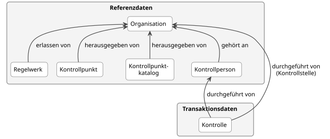{fig-alt="Ausschnitt aus dem konzeptionellen Datenmodell: die Beziehungen von Regelwerk, Kontrollpunkt, Kontrollpunktkatalog, Kontrollperson und Kontrolle zur Organisation"}

Organisationen haben im Kontrollwesen verschiedene Rollen: Sie erlassen Regelwerke, geben Kontrollpunkte heraus oder führen als Kontrollstelle Kontrollen durch.
Das Datenmodell kennt dafür nur eine Klasse Organisation.
Welche Rolle eine Organisation hat, ergibt sich aus der Beziehung, zum Beispiel «herausgegeben von» beim Kontrollpunkt oder «durchgeführt von» bei der Kontrolle.

Wir haben uns aus folgenden Gründen dafür entschieden:

- **Dieselbe Organisation kann mehrere Rollen haben.**
  Ein kantonales Veterinäramt gibt zum Beispiel eigene Kontrollpunkte heraus und führt auch Kontrollen durch.
  Mit einer einzigen Klasse wird es nur einmal erfasst.
- **Neue Rollen brauchen keine neue Klasse.**
  Kommt eine Rolle hinzu, zum Beispiel Zertifizierungsstelle, genügt eine neue Beziehung.
- **Die Kontrollstelle ist kein freier Text mehr.**
  Die Kontrolle verweist auf eine Organisation, statt deren Namen als Text zu erfassen.

Organisationen werden über die Unternehmens-Identifikationsnummer (UID) identifiziert [@uid-register].
Alle Organisationen im Kontrollwesen haben eine UID, auch Bundesämter, kantonale Ämter und Vereine.
:::

#### Kontrollpunktkataloge der Herausgeberinnen {#sec-decision-catalogues}

::: {.entscheid}
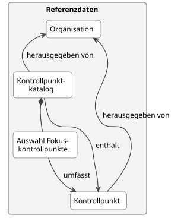{fig-alt="Ausschnitt aus dem konzeptionellen Datenmodell: Kontrollpunktkatalog mit Auswahl der Fokuskontrollpunkte, Kontrollpunkt und Organisation"}

Die Herausgeberinnen ändern ihre Kontrollpunkte in unterschiedlichem Rhythmus:

- **Bund:** Das BLW veröffentlicht die Kontrollpunkte und Fokuskontrollpunkte des Bundes jeweils Ende August für das Folgejahr (Art. 9 Abs. 2 VKKL [@vkkl]).
  Dabei übernimmt es auch die Fokuskontrollpunkte des BLV zum Tierschutz.
  Sie gelten jeweils ab dem 1. Januar.
- **Label-Organisationen:** Sie passen ihre Richtlinien und damit ihre Kontrollpunkte deutlich häufiger an, auch unterjährig (@sec-control-point-hierarchy).
  Häufig handelt es sich um Lockerungen, befristete Ausnahmen oder die Aufhebung einzelner Anforderungen.

Das Datenmodell bildet beides gleich ab: Jede Herausgeberin veröffentlicht ihre gültigen Kontrollpunkte in einem Kontrollpunktkatalog.
Ein Katalog hat ein Publikationsdatum und einen Gültigkeitszeitraum.
Ändert eine Herausgeberin ihre Kontrollpunkte, veröffentlicht sie eine neue Ausgabe ihres Katalogs, beim BLW einmal im Jahr, bei einer Label-Organisation so oft wie nötig.
Zu einem Katalog kann eine Auswahl der Fokuskontrollpunkte gehören, die bei einer Grundkontrolle zwingend geprüft werden müssen.
Heute gibt es solche Auswahlen nur im Katalog des Bundes, gestützt auf die VKKL.
Ob ein Kontrollpunkt ein Fokuskontrollpunkt ist, ist also kein Merkmal des Kontrollpunkts selbst.

Wir haben uns aus folgenden Gründen dafür entschieden:

- **Ein Modell für alle Rhythmen.**
  Der Katalog ist nicht an das Kalenderjahr gebunden.
  Jährliche und unterjährige Änderungen werden auf die gleiche Weise ausgetauscht.
- **Nachvollziehbar, was zum Kontrollzeitpunkt galt.**
  Kontrollpunkte und Kataloge haben einen Gültigkeitszeitraum.
  Auch bei unterjährigen Änderungen ist für jede Kontrolle klar, welche Fassung eines Kontrollpunkts geprüft wurde.
- **Unveränderte Kontrollpunkte bleiben bestehen.**
  Eine neue Ausgabe eines Katalogs enthält auch die Kontrollpunkte, die sich nicht geändert haben.
  Sie erhalten keine neue Version, nur weil sich andere Kontrollpunkte oder die Auswahl der Fokuskontrollpunkte geändert haben.
- **Die Kantone erhalten alles in einer Lieferung.**
  Die kantonale Kontrollkoordinationsstelle braucht die gültigen Kontrollpunkte und die Fokuskontrollpunkte, um die Grundkontrollen in Kontrollpakete aufzuteilen.
  Beides ist im gleichen Katalog enthalten.
- **Das Modell ist offen für weitere Herausgeberinnen.**
  Grundsätzlich kann jede Organisation Kontrollpunkte herausgeben.
  Bund, Kantone, Label-Organisationen und künftig weitere Organisationen veröffentlichen ihre Kontrollpunkte je in einem eigenen Katalog und in ihrem eigenen Rhythmus.
  Kommt eine neue Herausgeberin hinzu, muss das Modell nicht angepasst werden.
:::

#### Ersetzung von Kontrollpunkten {#sec-decision-replacement}

::: {.entscheid}
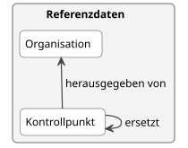{fig-alt="Ausschnitt aus dem konzeptionellen Datenmodell: Kontrollpunkt mit der Beziehung ersetzt und seiner Herausgeberin"}

Herausgeberinnen ändern ihre Kontrollpunkte regelmässig, der Bund jährlich, Label-Organisationen auch unterjährig.
Ändert sich ein Kontrollpunkt inhaltlich, entsteht ein neuer Kontrollpunkt.
Er verweist ausdrücklich auf den Kontrollpunkt, den er ersetzt.
Der frühere Kontrollpunkt bleibt bestehen, ist aber nicht mehr gültig.

Wir haben uns aus folgenden Gründen dafür entschieden:

- **Der Nachfolger ist eindeutig erkennbar.**
  Heute lässt sich ein Nachfolger nur an Namensregeln erkennen, zum Beispiel an einer Endung wie «_v2» oder «_2027» in der Masterliste.
  Ohne ausdrücklichen Verweis ist nicht klar, ob ein neuer Kontrollpunkt einen bisherigen ersetzt oder zusätzlich dazukommt.
- **Auswertungen über mehrere Jahre bleiben möglich.**
  Kontrollergebnisse zu einem früheren und zu einem neuen Kontrollpunkt lassen sich über die Ersetzung miteinander vergleichen.
- **Es bleibt nachvollziehbar, was geprüft wurde.**
  Frühere Beobachtungen verweisen weiterhin auf den Kontrollpunkt, der zum Kontrollzeitpunkt galt.
- **Kontrollpunkte können aufgeteilt oder zusammengelegt werden.**
  Ein neuer Kontrollpunkt kann mehrere frühere ersetzen, und mehrere neue können einen früheren ersetzen.

Ein Kontrollpunkt ersetzt nur Kontrollpunkte derselben Herausgeberin.
:::

#### Erforderliche Qualifikation pro Kontrollpunkt {#sec-decision-qualification}

::: {.entscheid}
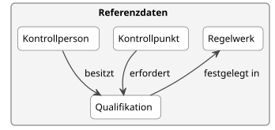{fig-alt="Ausschnitt aus dem konzeptionellen Datenmodell: Kontrollpunkt erfordert Qualifikation, Qualifikation festgelegt in Regelwerk"}

Gewisse Kontrollpunkte dürfen nur Kontrollpersonen mit einer bestimmten Qualifikation abschliessend prüfen.
Zwei Beispiele aus den Technischen Weisungen des BLV [@blv-tw-primaerproduktion]:

- Kontrollen von Honigbienenhaltungen müssen durch amtliche Fachassistentinnen und Fachassistenten Bienen durchgeführt werden.
- Bei der Gesundheitsüberwachung von Wassertieren muss die Tierärztin oder der Tierarzt Erfahrung mit der Gesundheit von Wassertieren haben.

Das Datenmodell kennt deshalb eine Klasse Qualifikation, zum Beispiel amtliche Tierärztin oder amtlicher Tierarzt, amtliche Fachexpertin oder amtlicher Fachexperte, amtliche Fachassistentin oder amtlicher Fachassistent.
Ein Kontrollpunkt kann eine oder mehrere Qualifikationen erfordern; erfordert er mehrere, genügt eine davon.
Eine Qualifikation kann in einem Regelwerk festgelegt sein, zum Beispiel in der Verordnung über die Aus-, Weiter- und Fortbildung der Personen im öffentlichen Veterinärwesen.

Wir haben uns aus folgenden Gründen dafür entschieden:

- **Es ist erkennbar, ob ein Ergebnis abschliessend ist.**
  Stellt eine Kontrollperson ohne die erforderliche Qualifikation etwas fest, zum Beispiel ungepflegte Klauen bei einer Kontrolle ausserhalb des Auftrags, ist klar, dass eine qualifizierte Kontrollperson nachprüfen muss (Anwendungsfall UC-17).
  Dazu hält die Kontrolle fest, mit welchen Qualifikationen sie durchgeführt wurde (@sec-decision-one-control-person).
- **Qualifikationen sind ein überschaubarer Katalog.**
  Sie werden von wenigen Organisationen festgelegt und gehören deshalb wie Regelwerke und Programme zu den Referenzdaten.
- **Die Anforderung steht beim Kontrollpunkt.**
  Auch wenn eine Qualifikation heute für eine ganze Rubrik gilt, wird sie bei jedem Kontrollpunkt erfasst.
  Ob Angaben für alle Kontrollpunkte eines Bereichs gelten sollen, ist eine offene Frage (@sec-open-questions).

Qualifikationen haben vorerst keine Struktur.
Dass zum Beispiel eine amtliche Tierärztin auch alles prüfen darf, was eine amtliche Fachassistentin prüfen darf, ist im Modell noch nicht abgebildet.
:::

#### Kontrollpersonen als schlanker Verweis {#sec-decision-control-persons}

::: {.entscheid}
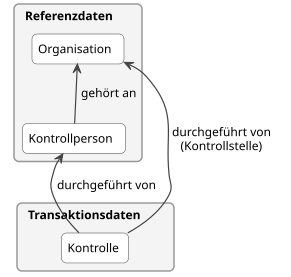{fig-alt="Ausschnitt aus dem konzeptionellen Datenmodell: Kontrollperson gehört einer Organisation an, die Kontrolle verweist auf die Kontrollperson"}

Damit ersichtlich ist, wer eine Kontrolle durchgeführt hat, kennt das Datenmodell eine Klasse Kontrollperson.
Die Bezeichnung entspricht dem Begriff des Fachglossars (@sec-glossary): eine natürliche Person, die im Auftrag einer Kontrollstelle Kontrollen durchführt.
Eine Kontrollperson gehört einer oder mehreren Organisationen an.
Sie wird nur über einen Identifikator erfasst, ohne Namen oder Adresse.
Den Identifikator vergibt eine Organisation, die ihre Kontrollpersonen in einer eigenen Liste führt, zum Beispiel eine Kontrollstelle.
Er ist nur zusammen mit dieser Organisation eindeutig.
Gehört eine Kontrollperson mehreren Organisationen an, kann sie mehrere Identifikatoren haben.

Wir haben uns aus folgenden Gründen dafür entschieden:

- **Personendaten bleiben geschützt.**
  Für den Austausch von Kontrolldaten genügt ein Identifikator.
  Namen und Kontaktangaben bleiben in den Verzeichnissen, die heute zum Beispiel das BLV, SwissGAP oder Agrosolution führen.
- **Kontrollpersonen sind Stammdaten.**
  Das Modell bildet nur ab, was für Kontrolldaten nötig ist, und überlässt die übrigen Angaben den bestehenden Verzeichnissen.
  Auch welche Qualifikationen eine Kontrollperson besitzt und wie lange sie gelten, verwalten die Organisationen.
:::

#### Eine Kontrollperson pro Kontrolle {#sec-decision-one-control-person}

::: {.entscheid}
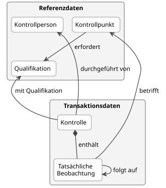{fig-alt="Ausschnitt aus dem konzeptionellen Datenmodell: Kontrolle durchgeführt von einer Kontrollperson mit Qualifikation, Kontrolle enthält Beobachtungen zu Kontrollpunkten, die eine Qualifikation erfordern"}

Eine Kontrolle wird von genau einer Kontrollperson durchgeführt.
Die Kontrolle hält fest, mit welchen Qualifikationen die Kontrollperson sie durchgeführt hat.
Die Beobachtungen verweisen nicht selbst auf eine Kontrollperson.
Wer sie festgestellt hat, ergibt sich aus der Kontrolle, zu der sie gehören.

Wir haben uns aus folgenden Gründen dafür entschieden:

- **Eine Kontrolle wird von einer Person durchgeführt.**
  Das Datenmodell bildet ab, wie Kontrollen heute durchgeführt werden.
- **Die Qualifikation steht nur einmal.**
  Sie wird pro Kontrolle erfasst und nicht bei jeder Beobachtung wiederholt.
- **Es ist erkennbar, ob ein Ergebnis abschliessend ist.**
  Erfordert ein Kontrollpunkt eine Qualifikation, ist eine Beobachtung abschliessend, wenn die Kontrolle mit einer dieser Qualifikationen durchgeführt wurde.
  Erfordert er keine, ist sie immer abschliessend.
- **Es gilt der Stand zum Zeitpunkt der Kontrolle.**
  Verliert eine Kontrollperson eine Qualifikation später, bleibt die Kontrolle unverändert.
  Wie lange eine Qualifikation gilt, muss das Datenmodell deshalb nicht abbilden.
- **Eine abschliessende Beurteilung ist eine eigene Kontrolle.**
  Beurteilt zum Beispiel eine Tierärztin ungepflegte Klauen, die ein Kontrolleur festgestellt hat, geschieht das in einer eigenen Kontrolle.
  Ihre Beobachtung folgt auf die Beobachtung des Kontrolleurs (@sec-decision-corrections).
:::

#### Korrektur und Folgebeobachtung {#sec-decision-corrections}

::: {.entscheid}
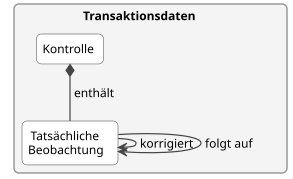{fig-alt="Ausschnitt aus dem konzeptionellen Datenmodell: Kontrolle enthält tatsächliche Beobachtungen, die einander korrigieren oder aufeinander folgen"}

Eine Beobachtung kann auf eine andere Beobachtung verweisen.
Das Datenmodell unterscheidet dabei zwei Fälle:

- **Korrektur:** Eine Beobachtung war falsch erfasst und wird berichtigt.
  Die neue Beobachtung korrigiert die alte.
  Die alte bleibt erhalten, gilt aber nicht mehr.
  Eine Beobachtung wird höchstens einmal direkt korrigiert.
  Ist auch die Korrektur falsch, wird sie ihrerseits korrigiert, und es gilt die letzte Beobachtung dieser Kette.
- **Folgebeobachtung:** Eine spätere Beobachtung baut auf einer früheren auf, zum Beispiel eine Nachkontrolle, ob ein Mangel behoben wurde, oder die abschliessende Beurteilung durch eine Tierärztin nach der Feststellung einer Fachassistentin.
  Die frühere Beobachtung bleibt gültig.

Wir haben uns aus folgenden Gründen dafür entschieden:

- **Korrektur und Nachkontrolle bedeuten Verschiedenes.**
  Bei einer Korrektur hat der festgestellte Mangel nie bestanden, bei einer Nachkontrolle wurde er behoben.
  Für Auswertungen ist dieser Unterschied entscheidend, deshalb gibt es zwei Beziehungen statt einer.
- **Nichts wird gelöscht.**
  Auch korrigierte Beobachtungen bleiben erhalten.
  So bleibt nachvollziehbar, was wann erfasst und geändert wurde.
- **Abschliessende Beurteilungen lassen sich verfolgen.**
  Stellt eine Kontrollperson ohne die erforderliche Qualifikation etwas fest, beurteilt eine qualifizierte Kontrollperson den Befund in einer eigenen Kontrolle.
  Ihre Beobachtung verweist auf die erste Beobachtung.
:::

#### Vordefinierte Mängel und flexible Abweichungen {#sec-decision-defects}

::: {.entscheid}
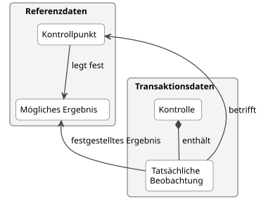{fig-alt="Ausschnitt aus dem konzeptionellen Datenmodell: Kontrollpunkt legt mögliche Ergebnisse fest, die tatsächliche Beobachtung verweist auf ein festgestelltes Ergebnis"}

Die Masterliste führt heute zu vielen Kontrollpunkten mögliche Mängel, zum Beispiel «Ungenügende Rückverfolgbarkeit der Abgaben».
Im Datenmodell sind diese vordefinierten Mängel mögliche Ergebnisse eines Kontrollpunkts.
Ein mögliches Ergebnis kann zusätzlich eine Mengeneinheit angeben, zum Beispiel «ha betroffene Fläche».

Die tatsächliche Beobachtung muss aber nicht auf ein vordefiniertes Ergebnis verweisen.
Sie hält immer ihr eigenes Ergebnis fest, zum Beispiel «Mangel», und kann eine Abweichung frei beschreiben und eine Menge angeben.
Damit sind drei Fälle möglich:

- ein vordefinierter Mangel, so wie er im Katalog steht,
- ein vordefinierter Mangel mit einer Beschreibung, wie der konkrete Fall davon abweicht,
- ein Mangel, der im Katalog nicht vorgesehen ist, nur mit freier Beschreibung.

Wir haben uns aus folgenden Gründen dafür entschieden:

- **Kataloge decken nie alle Fälle ab.**
  Die Masterliste 2027 enthält deshalb bei 604 von 610 Kontrollpunkten mit vordefinierten Mängeln zusätzlich den allgemeinen Eintrag «Anderer Mangel».
  Abweichungen zu den vordefinierten Mängeln sollen flexibel erfasst werden können.
- **Vordefinierte Mängel bleiben auswertbar.**
  Wo ein vordefinierter Mangel passt, wird er verwendet und lässt sich über alle Kontrollen hinweg zählen.
- **Mengen zeigen das Ausmass eines Mangels.**
  Wie schwer ein Mangel wiegt, hängt oft von einer Menge ab, zum Beispiel von der betroffenen Fläche oder von der Anzahl fehlender Auslauftage.

Ist das Ergebnis einer Beobachtung «Mangel», muss mindestens ein vordefinierter Mangel oder eine freie Beschreibung der Abweichung angegeben sein.
:::

### Offene Fragen {#sec-open-questions}

Die Kontrollpunkte sollen künftig neu formuliert werden.
Das Datenmodell verwendet heute die bestehenden Kontrollpunkte.
Eine Anforderung muss dabei nur einmal erfasst werden, auch wenn mehrere Kontrollpunkte sie prüfen.
Für die Neuformulierung und für die Massnahmen sind folgende Fragen noch offen:

- **Geltungsbereich:** Viele Kontrollpunkte werden heute wiederholt, weil sie für verschiedene Tierkategorien, Kulturen oder Betriebsarten gelten.
  Soll ein Kontrollpunkt künftig einen Geltungsbereich als Merkmal haben, und gehört dieser zur Anforderung, zum Kontrollpunkt oder zu beiden?
- **Übergreifende Anforderungen:** Manche Anforderungen gelten für alle Kontrollpunkte eines Programms oder eines Bereichs, zum Beispiel vollständige Aufzeichnungen.
  Sollen solche Anforderungen für alle Kontrollpunkte darunter gelten, oder verweist jeder Kontrollpunkt ausdrücklich auf sie?
- **Ausnahmen:** Ausnahmen wie «Suhlen für Yaks und Wasserbüffel» lockern oder heben andere Anforderungen für einen bestimmten Fall auf.
  Wie werden solche Ausnahmen erfasst, auch wenn sie nur befristet gelten?
- **Massnahmen:** Massnahmen und Sanktionen sind noch nicht modelliert.
  Zu klären ist, wie vorgeschlagene Massnahmen, zum Beispiel die Sanktionen in der Masterliste, und tatsächlich angeordnete Massnahmen abgebildet werden, welche Arten es braucht, zum Beispiel Sanktionspunkte oder Kürzungen in CHF, und ob angeordnete Massnahmen als besonders schützenswerte Daten überhaupt ausgetauscht werden dürfen.

## Logisches Datenmodell {#sec-logical-model}

Das logische Datenmodell (@fig-logical-model) beschreibt, wie das konzeptionelle Datenmodell im Resource Description Framework (RDF) [@rdf] umgesetzt wird.
Es richtet sich an Personen, die Systeme entwickeln oder Daten austauschen.
Die Klassen und Beziehungen entsprechen dem konzeptionellen Datenmodell.
Hinzu kommen die Attribute, ihre Kardinalitäten sowie die verwendeten Vokabulare und Datentypen:

- **SKOS** [@skos] für die Gliederung, den Katalog und die Auswahl der Fokuskontrollpunkte,
- **schema.org** [@schemaorg] für allgemeine Merkmale wie Name, Beschreibung, Gültigkeit und Identifikatoren,
- **Dublin Core** [@dcterms] für die Ersetzung von Kontrollpunkten (`dcterms:replaces`),
- **PROV-O** [@prov-o] für die Korrektur von Beobachtungen (`prov:wasRevisionOf`),
- **XML-Schema-Datentypen** (`xsd:`) und mehrsprachige Texte (`rdf:langString`) für die Werte.

Merkmale ohne Präfix werden im Namensraum von eCH-0264 definiert.

| Konzeptionelles Datenmodell | Logisches Datenmodell |
|---|---|
| Gliederungselement | `skos:Concept` |
| Gliederungselement übergeordnet | `skos:broader` |
| Kontrollpunktkatalog | `skos:ConceptScheme` |
| Kontrollpunktkatalog enthält Kontrollpunkt | `skos:inScheme` (vom Kontrollpunkt zum Katalog) |
| Auswahl Fokuskontrollpunkte | `skos:Collection` |
| Auswahl umfasst Kontrollpunkt | `skos:member` |
| Kontrollpunkt ersetzt Kontrollpunkt | `dcterms:replaces` |
| Beobachtung korrigiert Beobachtung | `prov:wasRevisionOf` |
| Beobachtung folgt auf Beobachtung | `folgtAuf` (Namensraum von eCH-0264) |
| Identifikator der Kontrollperson | `schema:identifier` mit einem `schema:PropertyValue` (`schema:value`, `schema:propertyID`) |
| Organisation, Kontrollperson, Qualifikation, Regelwerk, Programm, Anforderung, Kontrollpunkt, Mögliches Ergebnis, Kontrolle, Tatsächliche Beobachtung, Anmeldung | Klassen im Namensraum von eCH-0264 |
| übrige Beziehungen | Merkmale im Namensraum von eCH-0264 |

: Abbildung des konzeptionellen auf das logische Datenmodell {#tbl-logical-mapping tbl-colwidths="[45,55]"}

{#fig-logical-model width="80%"}

### Modellierungsentscheide {#sec-logical-modelling-decisions}

#### SKOS für Gliederung, Katalog und Fokuskontrollpunkte {#sec-decision-skos}

::: {.entscheid}
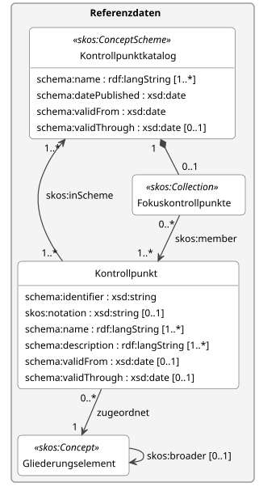{fig-alt="Ausschnitt aus dem logischen Datenmodell: Kontrollpunkt, Gliederungselement als skos:Concept, Kontrollpunktkatalog als skos:ConceptScheme und Fokuskontrollpunkte als skos:Collection"}

Die Gliederungselemente werden als `skos:Concept` umgesetzt und über `skos:broader` verschachtelt.
Ein Kontrollpunktkatalog ist ein `skos:ConceptScheme`, die Auswahl der Fokuskontrollpunkte eine `skos:Collection`.

Wir haben uns aus folgenden Gründen dafür entschieden:

- **SKOS ist ein bewährter Standard.**
  SKOS [@skos] ist eine Empfehlung des W3C für Begriffssysteme und Klassifikationen.
  Es bietet Bezeichnungen in mehreren Sprachen, Codes (`skos:notation`) und Gruppierungen (`skos:Collection`) bereits an.
- **Kontrollpunkte verschiedener Kataloge lassen sich verknüpfen.**
  Mit SKOS kann man festhalten, dass ein Punkt eines Katalogs einem Punkt eines anderen Katalogs entspricht (`skos:exactMatch`, `skos:closeMatch`).
  Das ist eine Voraussetzung, damit Kontrolldaten zwischen den Systemen weiterverwendet werden können.
- **Das Fachglossar verwendet ebenfalls SKOS.**
  Das Fachglossar (@sec-glossary) ist als SKOS-Konzeptschema modelliert, die Daten bleiben dadurch einheitlich.
:::

#### Prüfregeln mit SHACL {#sec-decision-shacl}

::: {.entscheid}
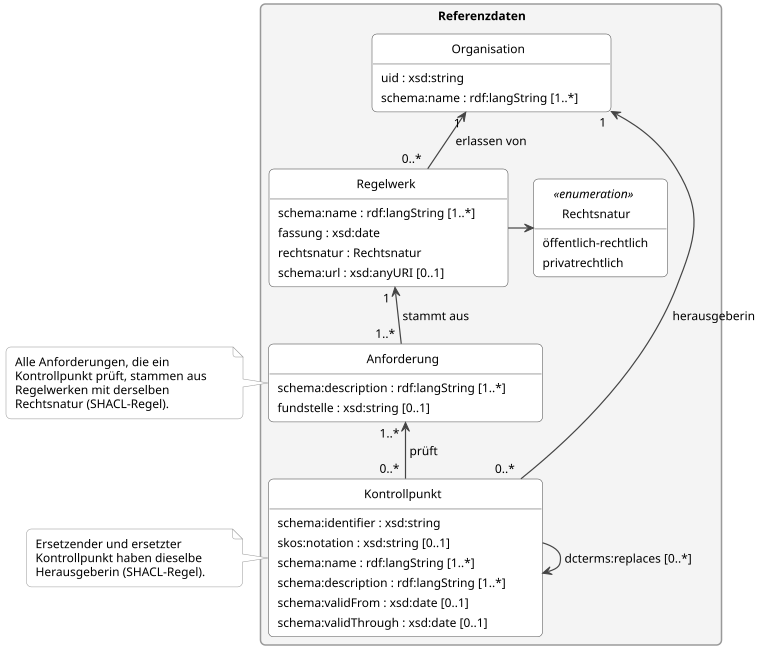{fig-alt="Ausschnitt aus dem logischen Datenmodell: Regelwerk mit Rechtsnatur, Anforderung, Kontrollpunkt und Organisation mit den Prüfregeln als Notizen"}

Einige Regeln lassen sich in einem Klassendiagramm nicht als Kardinalität ausdrücken.
Sie werden in der technischen Umsetzung als SHACL-Regeln [@shacl] geprüft:

- Alle Anforderungen, die ein Kontrollpunkt prüft, stammen aus Regelwerken mit derselben Rechtsnatur.
- Ein Kontrollpunkt ersetzt nur Kontrollpunkte derselben Herausgeberin.
- Ist das Ergebnis einer Beobachtung «Mangel», ist ein vordefinierter Mangel oder eine freie Beschreibung der Abweichung angegeben.
- Der Identifikator einer Kontrollperson ist innerhalb der Organisation, die ihn vergibt, eindeutig.
- Eine Beobachtung wird höchstens einmal direkt korrigiert, damit klar ist, welche Korrektur gilt.

Die Rechtsnatur wird nur beim Regelwerk erfasst und nicht beim Kontrollpunkt wiederholt, damit sich die Angaben nicht widersprechen können.
:::

#### Neue Kontrollpunkte statt Versionsnummern {#sec-decision-no-versions}

::: {.entscheid}
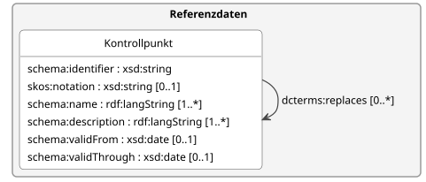{fig-alt="Ausschnitt aus dem logischen Datenmodell: Kontrollpunkt mit der Beziehung dcterms:replaces"}

Ein Kontrollpunkt hat keine Versionsnummer.
Ändert sich ein Kontrollpunkt inhaltlich, erhält der neue Kontrollpunkt eine eigene IRI und verweist mit `dcterms:replaces` auf den früheren.

Wir haben uns aus folgenden Gründen dafür entschieden:

- **Eine IRI steht immer für denselben Inhalt.**
  Eine Beobachtung, die auf einen Kontrollpunkt verweist, bezieht sich damit immer auf genau den Wortlaut, der geprüft wurde.
- **Version und Ersetzung lassen sich nicht verwechseln.**
  Mit Versionsnummern und Ersetzungen gäbe es zwei Wege, dieselbe Änderung festzuhalten.
  Mit nur einem Weg bleiben die Daten eindeutig.
:::

#### Identifikator mit vergebender Organisation {#sec-decision-identifier}

::: {.entscheid}
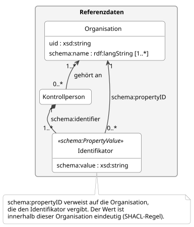{fig-alt="Ausschnitt aus dem logischen Datenmodell: Kontrollperson mit Identifikatoren als schema:PropertyValue, die auf die vergebende Organisation verweisen"}

Der Identifikator einer Kontrollperson wird als `schema:PropertyValue` erfasst.
`schema:value` enthält den Identifikator, zum Beispiel eine Personalnummer.
`schema:propertyID` verweist auf die Organisation, die ihn vergeben hat und ihre Kontrollpersonen in einer Liste führt.

Wir haben uns aus folgenden Gründen dafür entschieden:

- **Ein Identifikator ist nur innerhalb einer Organisation eindeutig.**
  Zwei Organisationen können denselben Identifikator vergeben.
  Erst zusammen mit der vergebenden Organisation ist er eindeutig.
- **Eine Kontrollperson kann mehrere Identifikatoren haben.**
  Gehört sie mehreren Organisationen an, kann sie von jeder einen eigenen erhalten.
- **Die Liste bleibt bei der Organisation.**
  Die Organisation führt ihre Kontrollpersonen mit Namen und Kontaktangaben in ihrem eigenen System.
  Das Datenmodell übernimmt davon nur den Identifikator.
  Eine Liste bei der Klasse Organisation würde dieselbe Angabe ein zweites Mal führen.
- **schema.org kennt dieses Muster.**
  Bei schema.org bezeichnet `schema:propertyID` das System, aus dem ein Identifikator stammt.
  Im Datenmodell ist das die Organisation, die ihre Kontrollpersonen in einer Liste führt.

Die vergebende Organisation muss nicht dieselbe sein, der die Kontrollperson angehört.
Führt zum Beispiel ein Verband ein Verzeichnis der Kontrollpersonen, kann er den Identifikator vergeben.
:::

#### PROV-O für Korrekturen, eigenes Merkmal für Folgebeobachtungen {#sec-decision-prov}

::: {.entscheid}
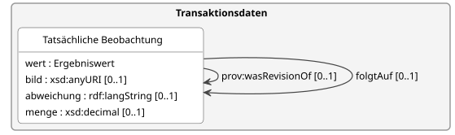{fig-alt="Ausschnitt aus dem logischen Datenmodell: tatsächliche Beobachtung mit prov:wasRevisionOf und folgtAuf"}

Eine Korrektur wird mit `prov:wasRevisionOf` aus PROV-O [@prov-o] erfasst.
Für die Folgebeobachtung verwendet das Modell ein eigenes Merkmal `folgtAuf` im Namensraum von eCH-0264.

Wir haben uns aus folgenden Gründen dafür entschieden:

- **PROV-O beschreibt Überarbeitungen.**
  `prov:wasRevisionOf` bedeutet, dass etwas eine überarbeitete Fassung von etwas anderem ist.
  Das passt genau auf eine Korrektur.
- **Für Folgebeobachtungen gibt es kein passendes Standardmerkmal.**
  Eine Nachkontrolle ist keine Überarbeitung der früheren Beobachtung, sondern eine neue Feststellung.
  Ein eigenes Merkmal verhindert, dass ein Standardmerkmal in einer anderen Bedeutung verwendet wird.
:::

# Haftungsausschluss {#sec-disclaimer}

eCH-Standards, die der Verein eCH dem Anwender kostenlos zur Verfügung stellt oder die auf eCH verweisen, haben nur den Status von Empfehlungen.
Der Verein eCH haftet in keinem Fall für Entscheidungen oder Massnahmen, die der Anwender auf der Grundlage dieser Dokumente trifft bzw. ergreift.
Der Anwender ist dafür verantwortlich, die Dokumente vor ihrer Verwendung selbst zu überprüfen und gegebenenfalls fachlichen Rat einzuholen.
eCH-Standards können und sollen die technische, organisatorische oder rechtliche Beratung im Einzelfall nicht ersetzen.

Dokumente, Verfahren, Methoden, Produkte und Standards, auf die in eCH-Standards verwiesen wird, sind möglicherweise durch Marken-, Urheber- oder Patentrechte geschützt.
Es liegt in der ausschliesslichen Verantwortung des Anwenders, die erforderlichen Lizenzen von den berechtigten Personen und/oder Organisationen einzuholen.

Obwohl der Verein eCH bei der Erstellung der eCH-Standards mit angemessener Sorgfalt vorgegangen ist, kann er keine Gewährleistung oder Garantie dafür übernehmen, dass die bereitgestellten Informationen und Dokumente aktuell, vollständig, richtig oder fehlerfrei sind.
eCH behält sich das Recht vor, die Inhalte der eCH-Standards jederzeit und ohne vorherige Ankündigung zu ändern.

Jede Haftung für Schäden, die durch die Nutzung der eCH-Standards durch den Anwender entstehen, wird im gesetzlich zulässigen Rahmen ausgeschlossen.

# Urheberrechte {#sec-copyrights}

Personen, die eCH-Standards erarbeiten, bleiben Inhaber ihrer geistigen Eigentumsrechte.
Diese Personen verpflichten sich jedoch, ihre geistigen Eigentumsrechte oder andere Rechte an geistigen Eigentumsrechten Dritter, soweit möglich, den jeweiligen Fachgruppen und dem Verein eCH kostenlos und zur uneingeschränkten Nutzung und Weiterentwicklung im Rahmen des Vereinszwecks zur Verfügung zu stellen.

Die von den Fachgruppen erarbeiteten Standards dürfen unter Nennung des jeweiligen Autors von eCH kostenlos und in uneingeschränktem Umfang genutzt, verbreitet und weiterentwickelt werden.

eCH-Standards sind vollständig dokumentiert und frei von lizenz- und/oder patentrechtlichen Einschränkungen.
Die dazugehörige Dokumentation kann kostenlos angefordert werden.
Diese Bestimmungen gelten jedoch nur für die von eCH erarbeiteten Standards, nicht aber für Standards oder Produkte Dritter, die auf eCH-Standards verweisen.
Die Standards enthalten die entsprechenden Hinweise auf Rechte Dritter.

# Anhang A - Referenzen {#sec-appendix-a .appendix .unnumbered}

::: {#refs}
:::

# Anhang B - Mitwirkung und Prüfung {#sec-appendix-b .appendix .unnumbered}

Folgende Personen wirken in der Arbeitsgruppe Landwirtschaftliche Kontrolldaten der eCH-Fachgruppe AgriFood mit.

| Name | Organisation |
|:--|:--|
| Peter Althaus | IP-Suisse |
| Matthias Baumann | Bundesamt für Landwirtschaft BLW |
| Marc Beringer | Bundesamt für Landwirtschaft BLW |
| Claudia Blumenstein | Bundesamt für Landwirtschaft BLW |
| Daniel Bretscher | Agroscope |
| Egon Brüstle | Modan AG |
| Lorenz Escher | Koordinationsgruppe Integrierte Produktion KIP |
| Jonas Eyer | Schweizer Bauernverband SBV |
| Florian Frauchiger | Vereinigung der Schweizer Kantonstierärztinnen und Kantonstierärzte VSKT |
| Marcel Friedli | Prométerre |
| Sara Gomez | Bio Suisse |
| Sabine Grob | Agriquali Schweizer Bauernverband |
| Simon Hasler | Bundesamt für Landwirtschaft BLW |
| Christoph Keller | Vereinigung der Schweizer Kantonstierärztinnen und Kantonstierärzte VSKT |
| Daniel Meyer | Bundesamt für Landwirtschaft BLW |
| Daniel Moos | bio.inspecta AG |
| Damian Oswald | Bundesamt für Landwirtschaft BLW |
| Sara Schärrer | Bundesamt für Lebensmittelsicherheit und Veterinärwesen BLV |
| Rahel Schelbert | Bundesamt für Landwirtschaft BLW |
| Monika Schober | Agrosolution AG |
| Lea Stauber | Bundesamt für Landwirtschaft BLW |
| Roman Steiger | Kontrolldienst KUT |
| Yuval Tempelman | Bundesamt für Lebensmittelsicherheit und Veterinärwesen BLV |
| Fiorella Tettamanti | Bundesamt für Lebensmittelsicherheit und Veterinärwesen BLV |
| Christian Wilda | Bundesamt für Landwirtschaft BLW |
| Meike Wollenberg Martínez | Mutterkuh Schweiz |
| Marie Zufferey | Kanton Wallis |

: Mitglieder der Arbeitsgruppe Landwirtschaftliche Kontrolldaten {#tbl-authors tbl-colwidths="[40,60]"}

# Anhang C - Abkürzungen und Glossar {#sec-appendix-c .appendix .unnumbered}



# Anhang D - Änderungen gegenüber der Vorversion {#sec-appendix-d .appendix .unnumbered}

Dies ist die erste Version des Standards.
Der Standard ersetzt die frühere Kurzbeschreibung «Dieser Standard soll dabei helfen, Begriffe und Daten im öffentlich-rechtlichen und privatrechtlichen Bereich des landwirtschaftlichen Kontrollwesens zu harmonisieren, so dass Kontrolldaten besser ausgetauscht beziehungsweise wiederverwendet werden können.»

# Anhang E - Abbildungsverzeichnis {#sec-appendix-e .appendix .unnumbered}



# Anhang F - Tabellenverzeichnis {#sec-appendix-f .appendix .unnumbered}


